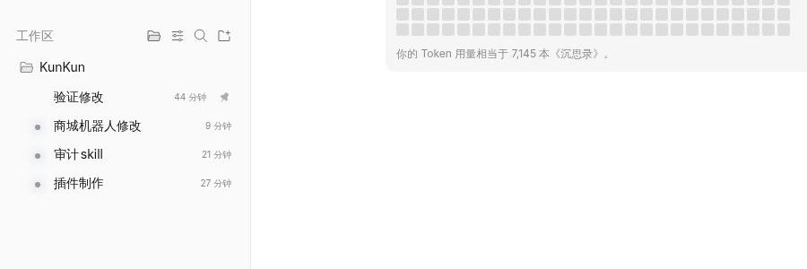

# dsh-fold-delete · Fold & delete sessions

[**简体中文**](README.md) · [English](README.en.md)


Collapse older messages in long conversations, and permanently delete sessions you no longer need — straight from the sidebar row.



> A DeepSeek Harness (DSH) plugin for DSH 0.2.0 or newer.

## What it does

Two everyday annoyances of long-running chats:

- A 500-message conversation scrolls forever — fold the older part, keep the recent messages
- Test sessions pile up and DSH's own sidebar has no delete action — add a real delete button that survives a refresh

## Features

**Fold older messages**

- Shows only the most recent N messages (default 20, configurable 5–200)
- A floating button at the top of the chat reveals more, or all of them
- Reasoning and tool calls are not counted
- Hide-only: message nodes stay in the DOM, nothing is written to disk
- Recomputed when the conversation changes or new messages arrive

**Delete a session for real**

- DSH 0.2.3+: hover a session row, a trash icon appears at the end of the row
- DSH 0.2.0–0.2.2: the session context menu → "Delete session"
- Confirmation dialog with an "I understand" checkbox; deletion cannot be undone

Deletion stops the running agent, flushes buffered messages, detaches the session from the in-memory store and broadcasts `api-session/removed`, removes the session directory and its projection cache, and cleans `workspace.json` — so it does not come back after a refresh.

## Installation

**Option 1 — plugin marketplace (recommended)**

Search `dsh-fold-delete` in DSH's plugin marketplace.

**Option 2 — release tarball**

```bash
dsh plugin --profile web add https://github.com/KunKun24/dsh-fold-delete/releases/download/v1.2.1/dsh-fold-delete-1.2.1.tgz
```

**Option 3 — local source**

```bash
dsh plugin --profile web add link:/path/to/dsh-fold-delete
```

Reload the page afterwards; no DSH restart is needed.

## Usage

- **Fold**: open any long conversation; the floating button reveals more, the count is configurable
- **Delete**: hover a session row → trash icon → tick the checkbox → confirm

## Configuration

Open "More → 对话设置" (chat settings) in the sidebar. Settings live in the local browser (`localStorage: dsh-fold-delete`) and are never uploaded.

| Option | Default | Range |
| --- | --- | --- |
| Recent messages shown | 20 | 5–200 |

## Compatibility

| DSH version | Delete entry | Slot |
| --- | --- | --- |
| 0.2.3+ | Trash icon on the session row | `sidebar.workspaces.session.row.action` |
| 0.2.0–0.2.2 | Context menu item | `sidebar.workspaces.session.menu.item` |

Both slots are registered; whichever does not exist on the running version is skipped safely.

Works with third-party sidebars that re-implement session rows (such as dsh-better-workspace): `row.action` is the official in-row button slot, so the icon lands to the right of "Archive" and "Pin".

## Data & privacy

- Folding only touches the DOM in your browser
- Deletion only touches local session files; no network requests are made
- No telemetry, nothing is uploaded

## Version & author

- Version **1.2.1** ([changelog](CHANGELOG.md))
- Author: 困困 (KunKun) · GitHub [@KunKun24](https://github.com/KunKun24) · Telegram [@sad1881](https://t.me/sad1881)
- License: [MIT](LICENSE)

Contains AIGC-assisted code, reviewed line by line and verified on a real instance.
