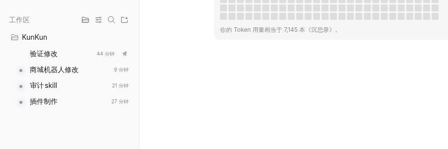

# dsh-fold-delete · 折叠与删除会话

[**简体中文**](README.md) · [English](README.en.md)


长对话只显示最近的消息，不再需要的会话从侧边栏行尾一键彻底删除。



> DeepSeek Harness（DSH）插件，需要 DSH 0.2.0 及以上。

## 它做什么

解决两件长对话里最常见的麻烦：

- 老会话几百条消息，每次打开都要从头滚到底 —— 折叠掉早先的部分，只留最近几条
- 试错留下的垃圾会话越堆越多，而 DSH 原生侧边栏没有删除入口 —— 加一个真正的删除按钮，删完刷新也不会回来

## 功能

**折叠较早的消息**

- 打开长对话只显示最近 N 条（默认 20，可在设置里改成 5–200），更早的收起来
- 对话顶部出现浮动按钮，点一次多显示一批，也可以「全部展开」
- 思考过程和工具调用不计入条数
- 只隐藏、不删除：消息节点仍在页面里，随时展开，不改动任何会话文件
- 切换会话、新消息到达后自动重新计算

**彻底删除会话**

- 新版 DSH（0.2.3+）：鼠标移到侧边栏会话行上，行尾出现垃圾桶按钮
- 旧版 DSH（0.2.0–0.2.2）：会话右键菜单 →「删除会话」
- 弹窗二次确认（勾选「我已了解」才能点确认），删除不可恢复

删除会依次停掉运行中的 agent、flush 缓冲消息、把会话从内存 store 摘掉并广播 `api-session/removed`、删除会话目录与投影缓存、从 `workspace.json` 的归档/置顶/工作区列表里摘掉 —— 所以刷新后不会再冒出来。

## 安装

**方式一：插件市场（推荐）**

在 DSH 的「插件市场」里搜索 `dsh-fold-delete` 直接安装。

**方式二：Release 包**

```bash
dsh plugin --profile web add https://github.com/KunKun24/dsh-fold-delete/releases/download/v1.2.1/dsh-fold-delete-1.2.1.tgz
```

**方式三：本地源码**

```bash
dsh plugin --profile web add link:/path/to/dsh-fold-delete
```

装完刷新页面即可，不需要重启 DSH。

## 使用

- **折叠**：打开任意长对话自动生效；顶部浮动按钮可继续展开，设置里可改显示条数
- **删除**：悬停会话行 → 点垃圾桶 → 勾选确认 → 确认删除

## 配置

侧边栏「更多 → 对话设置」里调整折叠条数、是否启用折叠等选项；设置保存在本机浏览器 `localStorage: dsh-fold-delete`，不上传任何地方。

| 选项 | 默认 | 范围 |
| --- | --- | --- |
| 显示最近消息数 | 20 | 5–200 |

## 兼容性

| DSH 版本 | 删除入口 | 用到的插槽 |
| --- | --- | --- |
| 0.2.3+ | 会话行悬停的垃圾桶按钮 | `sidebar.workspaces.session.row.action` |
| 0.2.0–0.2.2 | 会话右键菜单 | `sidebar.workspaces.session.menu.item` |

两个插槽同时注册，当前版本不存在的那一个会被安全跳过。

在自带会话行的第三方侧边栏主题（例如 dsh-better-workspace）下同样可用：`row.action` 是官方行内按钮位，会排在「归档」「置顶」右侧。

## 数据与隐私

- 折叠只在浏览器里改 DOM，不写入任何数据
- 删除只操作本机会话文件，不发网络请求
- 插件不收集任何信息，也不上传任何内容

## 版本与作者

- 当前版本 **1.2.1**（[更新日志](CHANGELOG.md)）
- 作者：困困 · GitHub [@KunKun24](https://github.com/KunKun24) · Telegram [@sad1881](https://t.me/sad1881)
- 许可证：[MIT](LICENSE)

包含 AIGC 辅助编写的内容，已逐行人工审阅并在真机验证。
